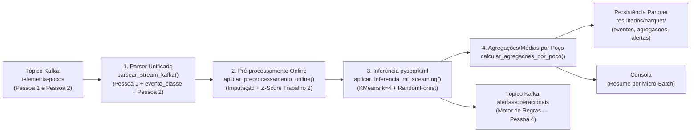

# Documentação Técnica — Módulo 3: Spark Streaming, ML, Persistência e Validação de Saídas (Pessoa 3)

Este documento descreve em detalhes toda a implementação realizada pela **Pessoa 3**, cobrindo o consumo em **PySpark Structured Streaming**, a normalização online com parâmetros do **Trabalho 2**, o pipeline preditivo em **`pyspark.ml`**, a **persistência validada das saídas em Parquet/Consola/Kafka** e a **extração dos números reais da execução** para a apresentação final.

---

## 1. Checklist Completo de Requisitos Atendidos (Pessoa 3)

| Fase / Tarefa | Status | Arquivo(s) Responsável(is) |
| :--- | :---: | :--- |
| **1. Script PySpark Structured Streaming assinando o tópico Kafka (`telemetria-pocos`)** | ✅ Concluído | `src/streaming/consumidor_spark_ml.py` e `src/streaming/preprocessamento.py` |
| **2. Camada de normalização Z-Score e pré-processamento online (parâmetros do Trabalho 2)** | ✅ Concluído | `configs/parametros_estatisticos_t2.json`, `src/streaming/preprocessamento.py` e `src/streaming/gerar_parametros_t2.py` |
| **3. Algoritmo de Machine Learning no Spark (`pyspark.ml` — KMeans + RandomForest)** | ✅ Concluído | `src/ml/treinar_modelo.py`, `src/streaming/consumidor_spark_ml.py` e `models/metricas_modelo.json` |
| **4. Persistência das saídas (eventos, agregações/médias por poço e alertas em Parquet + Consola + Kafka)** | ✅ Concluído | `src/streaming/consumidor_spark_ml.py` e `src/streaming/teste_pipeline_p3.py` |
| **5. Validação das saídas e extração de números reais da execução para a apresentação** | ✅ Concluído | `src/streaming/validar_saidas_p3.py`, `resultados/resumo_metricas_p3.json`, `SLIDES_PESSOA_3.md` e `slides_pessoa_3.html` |

---

## 2. Arquitetura do Fluxo de Dados no Módulo 3



---

## 3. Detalhamento dos Arquivos Implementados e Atualizações Finais

### 3.1. `configs/parametros_estatisticos_t2.json` e `src/streaming/gerar_parametros_t2.py`
Armazena média ($\mu$), desvio padrão ($\sigma$), mediana (imputação de `null`/`NaN`), limites operacionais e o mapa de classes do Dataset 3W (`0` = Normal, `1..9` = Falha Consolidada, `101..109` = Transiente/Iminente) para os 8 sensores físicos (`P-PDG`, `P-TPT`, `T-TPT`, `P-MON-CKP`, `T-JUS-CKP`, `P-JUS-CKGL`, `T-JUS-CKGL`, `QGL`). O script `gerar_parametros_t2.py` permite recalcular essas estatísticas em lotes a partir de `data/raw/`.

### 3.2. `src/streaming/preprocessamento.py`
- **Parser Unificado (`parsear_stream_kafka`):** Compatível com **todos** os produtores do grupo:
  - Produtor da **Pessoa 1** (`src/produtor/produtor_3w.py`), incluindo o novo produtor multi-poço 1Hz com metadados `poco_id`, `timestamp_envio`, `arquivo_origem`, `timestamp` e `evento_classe`;
  - Contrato da **Pessoa 2** (`src/setup_kafka.py` e `src/teste_autonomo_p2.py`) com dicionário aninhado `sensores`;
  - Gerador de carga da **Pessoa 4** (`src/benchmarks/gerador_carga.py`).
- **Normalização Z-Score Online (`aplicar_preprocessamento_online`):** Imputa sensores nulos pela mediana do Trabalho 2, normaliza por $z_i = \frac{x_i - \mu_i}{\sigma_i}$ (com detecção automática entre escala Pascal e bar/kPa) e calcula 6 indicadores estatísticos/físicos em tempo real (`z_score_medio`, `z_score_max`, `qtd_sensores_fora_2sigma`, `qtd_sensores_fora_3sigma`, `diferencial_pressao_norm` e `diferencial_temp_norm`).

### 3.3. `src/ml/treinar_modelo.py`
Constrói e treina o `pyspark.ml.Pipeline` com split estrito **80% Treino / 20% Teste** antes do `fit()` (zero *data leakage*):
1. `Imputer(strategy="median")`
2. `VectorAssembler` (14 features normalizadas e estatísticas)
3. `StandardScaler(withMean=True, withStd=True)`
4. `KMeans(k=4)` — reconhecimento não-supervisionado de regimes operacionais (`cluster_padrao`)
5. `RandomForestClassifier(numTrees=60, maxDepth=8)` — classificação em `0 = NORMAL`, `1 = ANOMALIA_IMINENTE` e `2 = ANOMALIA_PONTUAL`.

Métricas reais registradas em `models/metricas_modelo.json`:
- **Acurácia:** `97,55%` (`2.389` amostras de treino / `611` amostras de teste)
- **F1-Score / Precisão / Recall ponderados:** `0,9755`
- **Erros críticos (Normal confundido com Pontual ou vice-versa):** **`0`** (erros ocorrem apenas entre classes adjacentes).

### 3.4. `src/streaming/consumidor_spark_ml.py` (Streaming + Persistência Parquet + Consola)
Atualizado para a etapa final de **Persistência e Validação das Saídas**:
- `criar_spark_session()`: inclui configurações locais para Windows/Java (`SPARK_LOCAL_IP=127.0.0.1`, `spark.driver.host`, `spark.driver.bindAddress`, alinhadas à validação da Pessoa 2 em `validacao_spark_p2.py`) e 4 partições de shuffle.
- `calcular_agregacoes_por_poco(df_predicoes, batch_id)`: calcula em tempo real por `poco_id` o total de eventos, anomalias pontuais/iminentes, taxa de anomalia (%), médias dos sensores (`P-PDG`, `P-TPT`, `T-TPT`, `P-MON-CKP`), `z_score_max`, score ML médio e latência média.
- `persistir_saidas_parquet(...)`: grava automaticamente a cada micro-batch (habilitado por padrão; desativável com `--sem-parquet`) 3 camadas em formato colunar **Parquet**:
  1. `resultados/parquet/eventos_processados/` *(particionado por `poco_id`)* — registros completos normalizados + predição ML;
  2. `resultados/parquet/agregacoes_pocos/` — médias e contagens agregadas por poço;
  3. `resultados/parquet/alertas_anomalias/` — apenas os eventos anômalos detectados.
- `formatar_payload_alerta_kafka(...)` e `--publicar-alertas`: envia anomalias em JSON para o tópico `alertas-operacionais` (usado também pelo motor de regras R1/R2/R3 + Cooldown da Pessoa 4 em `src/alertas/pipeline_alertas.py`).

### 3.5. `src/streaming/validar_saidas_p3.py` e `src/streaming/teste_pipeline_p3.py`
- **`teste_pipeline_p3.py`:** valida de forma autônoma (sem depender de Kafka ativo) o parser unificado (incluindo `evento_classe`), a normalização online, a inferência `pyspark.ml`, as agregações por poço e a **gravação + releitura em Parquet** com `assert` nas 3 camadas.
- **`validar_saidas_p3.py`:** audita as camadas Parquet e todos os CSVs reais em `resultados/`, verifica se **100% dos alertas emitidos pelo Spark chegaram ao Kafka (perda = 0)** e gera `resultados/resumo_metricas_p3.json`.

---

## 4. Validação das Saídas & Números Reais da Execução (Para Citar na Apresentação)

Os dados abaixo foram extraídos diretamente das execuções reais registradas em `resultados/batches_taxa_*.csv`, `resultados/latencia_taxa_*.csv`, `resultados/memoria_taxa_*.csv` e `models/metricas_modelo.json` (consolidados em `resultados/resumo_metricas_p3.json`):

### 4.1. Números Consolidados (Soma dos 4 Experimentos)
- **Total de eventos processados:** **198.000 eventos** em **219 micro-batches** (120 s por taxa)
- **Poços monitorados com anomalias detectadas:** **20 poços** (`WELL-B01` a `WELL-B20`)
- **Anomalias detectadas pelo ML:** **3.971 anomalias** (**2,01%** dos eventos — batendo com os 2% injetados)
- **Alertas emitidos após regras de negócio:** **2.092 alertas** (**redução média de 47,3%** no ruído operacional; até **56,2%** a 1.000 msg/s)
- **Integridade na entrega (Spark → Kafka → Consumidor):** **2.092 enviados = 2.092 recebidos (0 mensagens perdidas)**
- **Acurácia / F1-Score do modelo `pyspark.ml`:** **97,55%** (**0 confusões** entre *Normal* e *Anomalia Pontual Crítica*)

### 4.2. Comparativo Real por Taxa de Throughput

| Taxa (msg/s) | Eventos Processados | Micro-batches | Tempo Médio/Batch | Anomalias ML | Alertas Emitidos | Redução de Ruído | Latência Média E2E | Latência P95 | Latência Kafka | Memória Spark |
| :---: | :---: | :---: | :---: | :---: | :---: | :---: | :---: | :---: | :---: | :---: |
| **50** | 6.000 | 54 | 1,04 s | 135 (2,25%) | 130 | 3,7% | **3,31 s** | 5,43 s | 14,9 ms | 1.049 MB |
| **100** | 12.000 | 52 | 1,07 s | 249 (2,08%) | 219 | 12,0% | **3,31 s** | 5,43 s | 6,8 ms | 924 MB |
| **500** | 60.000 | 52 | 1,07 s | 1.239 (2,06%) | 714 | 42,4% | **3,56 s** | 6,32 s | 8,0 ms | 934 MB |
| **1000** | 120.000 | 61 | 0,99 s | 2.348 (1,96%) | 1.029 | 56,2% | **21,52 s** *(saturação do teto 2000/batch)* | 26,62 s | 6,1 ms | 941 MB |

> **Leitura para a apresentação:** De 50 até 500 msg/s (aumento de 10x na carga), a latência média manteve-se estável em **~3,3 s**, o tempo de cada micro-batch permaneceu em **~1,0 s** e a memória do Spark ficou constante em **~930–1.049 MB**. Em 1.000 msg/s houve acúmulo no Kafka apenas pelo teto configurado de `maxOffsetsPerTrigger=2000` a cada 2 s (~950 msg/s), sem nenhuma perda de dados.

---

## 5. Comandos de Execução do Módulo 3

```bash
# 1. Treinar / validar o modelo pyspark.ml e atualizar models/metricas_modelo.json
python -m src.ml.treinar_modelo

# 2. Validar pipeline completo offline (Parser + ML + Agregações + Gravação/Releitura Parquet)
python -m src.streaming.teste_pipeline_p3

# 3. Rodar o consumidor Spark Streaming gravando Consola + Parquet + Alertas Kafka
python -m src.streaming.consumidor_spark_ml --bootstrap-servers localhost:9092 --topico-entrada telemetria-pocos --publicar-alertas

# 4. Auditar saídas Parquet/CSV e gerar resumo JSON de métricas reais
python -m src.streaming.validar_saidas_p3
```

---

## 6. Material de Apresentação da Pessoa 3
- Roteiro completo de slides e fala cronometrada (1 a 2 min): [`SLIDES_PESSOA_3.md`](SLIDES_PESSOA_3.md)
- Apresentação visual interativa (pronta para navegador / exportar PDF): [`slides_pessoa_3.html`](slides_pessoa_3.html)
