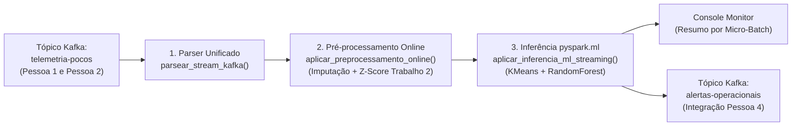

# Documentação Técnica — Módulo 3: Consumo em Spark Streaming e Pipeline de ML (Pessoa 3)

Este documento descreve em detalhes toda a implementação realizada pela **Pessoa 3**, explicando a arquitetura interna, as fórmulas de normalização online baseadas no **Trabalho 2**, o pipeline de Machine Learning (`pyspark.ml`) e os **pontos exatos de integração** com os módulos da **Pessoa 1**, **Pessoa 2** e **Pessoa 4**.

---

## 1. Checklist de Requisitos Atendidos (Pessoa 3)

| Tarefa da Especificação | Status | Arquivo(s) Responsável(is) |
| :--- | :---: | :--- |
| **1. Script PySpark com Structured Streaming para assinar o tópico Kafka do grupo (`telemetria-pocos`)** | ✅ Concluído | `src/streaming/consumidor_spark_ml.py` e `src/streaming/preprocessamento.py` |
| **2. Camada de normalização e pré-processamento online utilizando os parâmetros estatísticos validados no Trabalho 2** | ✅ Concluído | `configs/parametros_estatisticos_t2.json`, `src/streaming/preprocessamento.py` e `src/streaming/gerar_parametros_t2.py` |
| **3. Algoritmo de Machine Learning no Spark (`pyspark.ml`) para reconhecimento de padrões e detecção de anomalias pontuais ou iminentes** | ✅ Concluído | `src/ml/treinar_modelo.py`, `src/streaming/consumidor_spark_ml.py` e `src/streaming/teste_pipeline_p3.py` |

---

## 2. Arquitetura do Fluxo de Dados no Módulo 3



---

## 3. Detalhamento dos Arquivos Implementados

### 3.1. `configs/parametros_estatisticos_t2.json`
Armazena os parâmetros estatísticos validados no **Trabalho 2** para os 8 sensores físicos do Dataset 3W da Petrobras:
- **`P-PDG`**: Pressão no *Permanent Downhole Gauge* (fundo do poço)
- **`P-TPT`**: Pressão no *Temperature and Pressure Transducer*
- **`T-TPT`**: Temperatura no *Temperature and Pressure Transducer*
- **`P-MON-CKP`**: Pressão a montante do *Choke* de Produção
- **`T-JUS-CKP`**: Temperatura a jusante do *Choke* de Produção
- **`P-JUS-CKGL`**: Pressão a jusante do *Choke* de *Gas Lift*
- **`T-JUS-CKGL`**: Temperatura a jusante do *Choke* de *Gas Lift*
- **`QGL`**: Vazão de *Gas Lift*

Para cada sensor são mantidos:
- `media` ($\mu$) e `desvio_padrao` ($\sigma$) na escala original em Pascal/°C do Dataset 3W;
- `mediana` para imputação online de sensores ausentes (`null`/`NaN`);
- `media_escala_reduzida` e `desvio_escala_reduzida` para suportar automaticamente eventos simulados em bar/kPa;
- `mapa_classes_3w`: Dicionário completo com os nomes das falhas `0` (Operação Normal), `1` a `9` (Anomalias Pontuais/Consolidadas) e `101` a `109` (Anomalias Transientes/Iminentes).

---

### 3.2. `src/streaming/gerar_parametros_t2.py`
Caso a equipe adicione novos arquivos `.parquet` na pasta `data/raw/`, este script percorre os arquivos **em lotes (streaming/batching do Trabalho 2)** acumulando soma, soma dos quadrados, mínimo, máximo e medianas por lote sem estourar a memória RAM, atualizando automaticamente o arquivo `configs/parametros_estatisticos_t2.json`.

---

### 3.3. `src/streaming/preprocessamento.py`

#### Compatibilidade Simultânea com Pessoa 1 e Pessoa 2 (`parsear_stream_kafka`)
No projeto, o produtor da **Pessoa 1** (`src/produtor/produtor_3w.py`) envia os sensores como chaves na raiz do JSON (ex.: `{"P-PDG": 452.12, "P-TP": 120.5, ...}`), enquanto o contrato de teste da **Pessoa 2** (`src/setup_kafka.py` e `src/teste_autonomo_p2.py`) envia um dicionário aninhado `{"sensores": {"P-PDG": 240.5, ...}}`.

A função `parsear_stream_kafka(df_kafka)` utiliza `F.coalesce(...)` para buscar cada sensor tanto nas colunas raiz (incluindo os aliases `P-TP`, `T-TP`, `P-MON-CK`, `T-JSC`) quanto dentro de `sensores.<nome>`. Assim, **ambos os produtores funcionam sem nenhuma modificação adicional**.

#### Normalização Z-Score e Engenharia de Atributos Online (`aplicar_preprocessamento_online`)
Para cada evento recebido em tempo real:
1. **Tratamento de Nulos (`NaN` / `None`):**
   - Calcula quantos sensores vieram preenchidos (`sensores_ativos`) e a proporção de falhas de leitura (`taxa_nulos_linha`).
   - Gera colunas imputadas (`<sensor>_imp`) substituindo nulos pela mediana histórica do Trabalho 2.
2. **Normalização Z-Score Online:**
   $$z_i = \frac{x_i - \mu_i}{\sigma_i}$$
   - Sensores nulos recebem $z_i = 0.0$ (equivalente à média da distribuição normalizada).
   - O valor é limitado ao intervalo $[-10.0, +10.0]$ para evitar que *outliers* extremos de falha de sensor corrompam o vetor numérico.
3. **Atributos Multivariados e Físicos Calculados em Streaming:**
   - `z_score_medio`: Média de $|z_i|$ entre os sensores ativos do evento.
   - `z_score_max`: Maior desvio $|z_i|$ observado no evento.
   - `qtd_sensores_fora_2sigma`: Número de sensores com $|z_i| \ge 2.0$ (indicador estatístico de **anomalia iminente/transiente**).
   - `qtd_sensores_fora_3sigma`: Número de sensores com $|z_i| \ge 3.0$ (indicador estatístico de **anomalia pontual crítica**).
   - `diferencial_pressao_norm`: $P_{\text{PDG, norm}} - P_{\text{TPT, norm}}$ (captura restrições de coluna, fechamento espúrio de DHSV e golfadas severas).
   - `diferencial_temp_norm`: $T_{\text{TPT, norm}} - T_{\text{JUS-CKP, norm}}$ (captura o efeito Joule-Thomson no *choke* de produção).

---

### 3.4. `src/ml/treinar_modelo.py`
Implementa o pipeline de treinamento e validação utilizando **`pyspark.ml`**:
1. **Prevenção de *Data Leakage*:** Os dados são divididos em **Treino (80%)** e **Teste (20%)** (`randomSplit([0.8, 0.2], seed=42)`) **antes** do `pipeline.fit(df_treino)`.
2. **Estágios do `pyspark.ml.Pipeline`:**
   - `Imputer(strategy="median")`: Garante ausência de nulos nas 14 features.
   - `VectorAssembler`: Agrupa as 14 colunas em `features_raw`.
   - `StandardScaler(withMean=True, withStd=True)`: Padroniza o vetor em `features`.
   - `KMeans(k=4)`: Reconhecimento não-supervisionado de padrões operacionais, gerando a coluna `cluster_padrao` (`0`, `1`, `2` ou `3`).
   - `RandomForestClassifier(numTrees=60, maxDepth=8)`: Classifica cada registro em 3 estados operacionais (`predicao_ml` e `probabilidade_ml`):
     - `0.0` $\rightarrow$ **`NORMAL`**
     - `1.0` $\rightarrow$ **`ANOMALIA_IMINENTE`** (classes transientes `101..109` do 3W ou deriva incipiente entre $2\sigma$ e $3\sigma$)
     - `2.0` $\rightarrow$ **`ANOMALIA_PONTUAL`** (classes de falha consolidada `1..9` do 3W ou desvio crítico $\ge 3\sigma$)
3. **Treinamento Autônomo:** Se a pasta `data/raw/` contiver arquivos Parquet do 3W, o treinamento amostra os arquivos em lotes; caso `data/raw/` esteja vazia no computador do integrante, o script gera automaticamente 3.000 registros sintéticos calibrados com os parâmetros do Trabalho 2 para treinar e salvar o modelo em `models/pipeline_ml_3w`.
4. **Métricas Exportadas (`models/metricas_modelo.json`):** Salva automaticamente *Accuracy*, *F1-Score*, *Weighted Precision*, *Weighted Recall* e a Matriz de Confusão para uso direto nos gráficos da **Pessoa 4**.

---

### 3.5. `src/streaming/consumidor_spark_ml.py`
É o motor principal de execução em tempo real:
- Inicializa a `SparkSession` carregando automaticamente o conector `org.apache.spark:spark-sql-kafka-0-10` compatível com a versão do PySpark instalada e configura `spark.sql.shuffle.partitions = 4` (alinhado às 4 partições do tópico `telemetria-pocos` definidas pela **Pessoa 2**).
- Carrega o `PipelineModel` de `models/pipeline_ml_3w` (ou executa o treinamento inicial automaticamente caso a pasta `models/` ainda não exista).
- Em cada micro-batch, aplica o pré-processamento online + `modelo_ml.transform()`, extrai as probabilidades por classe (`prob_normal`, `prob_anomalia_iminente`, `prob_anomalia_pontual`, `score_anomalia_ml`, `confianca_predicao`) e define:
  - `status_operacional`: `"NORMAL"`, `"ANOMALIA_IMINENTE"` ou `"ANOMALIA_PONTUAL"`
  - `severidade`: `"NORMAL"`, `"ALERTA_PREVENTIVO"` ou `"CRITICA"`
  - `diagnostico_padrao`: Nome descritivo da falha no Dataset 3W (ex.: `"Golfada Severa (Severe Slugging)"`, `"Transiente/Iminente: Restricao Rapida em PCK"`).
  - `latencia_end_to_end_ms`: $(t_{\text{inferencia}} - t_{\text{envio}}) \times 1000$, medindo em milissegundos o tempo total desde o disparo pelo Produtor Kafka (Pessoa 1) até a conclusão da predição no Spark (Pessoa 3).

---

## 4. Guia de Integração para os Outros Integrantes

### Para a Pessoa 1 (Produtor Kafka) e Pessoa 2 (Infraestrutura Kafka)
- O consumidor Spark assina por padrão `localhost:9092` e o tópico `telemetria-pocos`.
- Ambos os esquemas JSON (`src/produtor/produtor_3w.py` da Pessoa 1 e `src/teste_autonomo_p2.py` da Pessoa 2) são reconhecidos automaticamente.

### Para a Pessoa 4 (Módulo de Alertas, Benchmarks e Relatório Técnico)
1. **Publicação no tópico `alertas-operacionais`:**
   Basta iniciar o consumidor passando a flag `--publicar-alertas`:
   ```bash
   python -m src.streaming.consumidor_spark_ml --publicar-alertas
   ```
   Toda mensagem classificada como `ANOMALIA_IMINENTE` ou `ANOMALIA_PONTUAL` é filtrada pela função `formatar_payload_alerta_kafka()` e enviada ao tópico `alertas-operacionais` com o seguinte JSON:
   ```json
   {
     "poco_id": "WELL-00003",
     "arquivo_origem": "WELL-00003_20180115091200.parquet",
     "timestamp_evento": "2026-11-04 10:30:00",
     "timestamp_envio": 1730727000.112,
     "timestamp_inferencia": 1730727000.298,
     "latencia_end_to_end_ms": 186.0,
     "status_operacional": "ANOMALIA_PONTUAL",
     "severidade": "CRITICA",
     "cluster_padrao": 2,
     "predicao_ml": 2.0,
     "score_anomalia_ml": 0.9612,
     "confianca_predicao": 0.9145,
     "z_score_medio": 3.412,
     "z_score_max": 4.536,
     "sensores_acima_2sigma": 6,
     "sensores_acima_3sigma": 4,
     "classe_real": 3,
     "diagnostico_padrao": "Golfada Severa (Severe Slugging)"
   }
   ```
2. **Medição de Latência End-to-End e Throughput (Benchmarks):**
   - O campo `latencia_end_to_end_ms` já entrega a latência fim a fim de cada evento (do `timestamp_envio` no Produtor Kafka até a saída do modelo ML no Spark).
   - O console também imprime, a cada micro-batch, a **Latência E2E média por status** e o **Tempo de processamento do micro-batch (ms)**.
3. **Métricas de Acurácia do Modelo para o Relatório Final:**
   - Ao rodar `python -m src.ml.treinar_modelo`, o arquivo `models/metricas_modelo.json` é gerado automaticamente contendo `accuracy`, `f1_score`, `weighted_precision`, `weighted_recall` e `matriz_confusao`.

