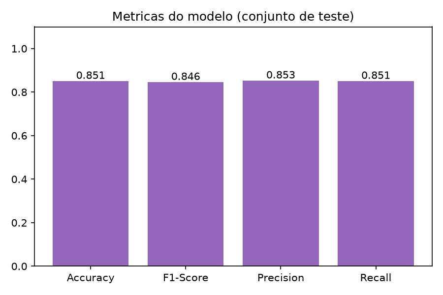
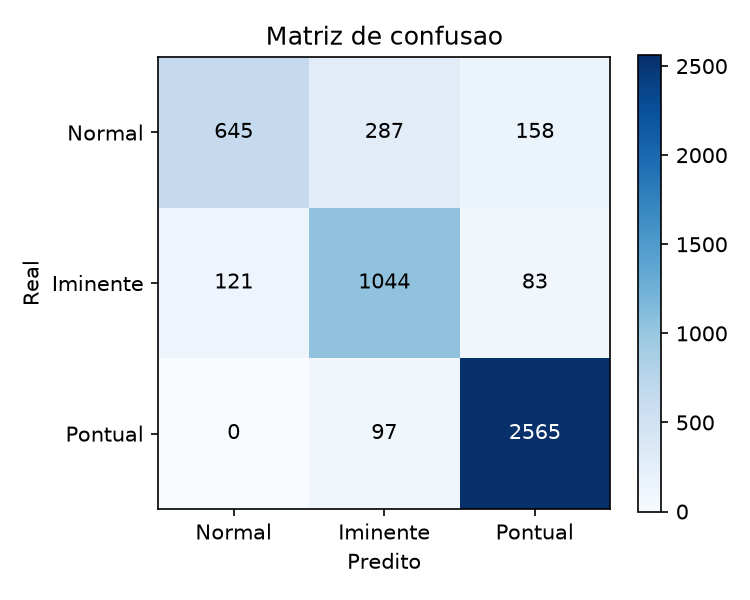
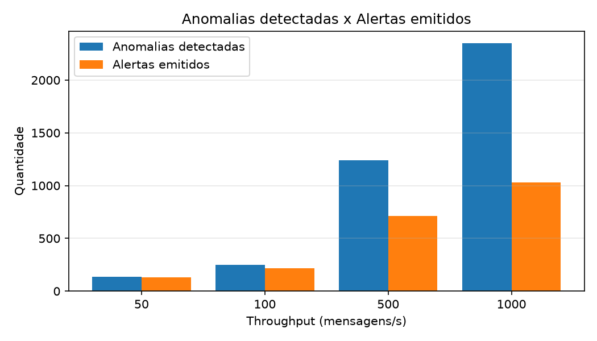
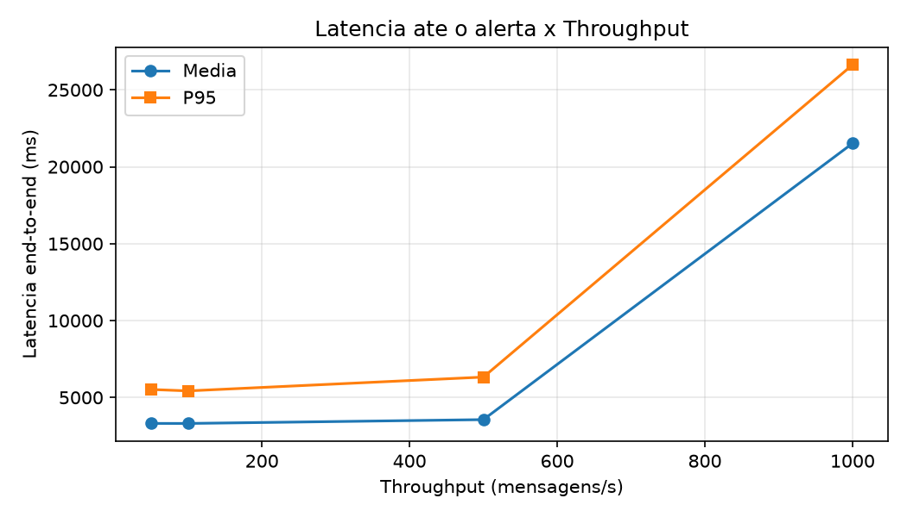
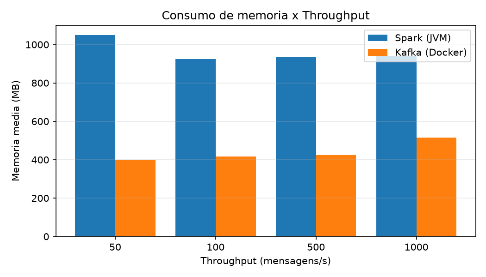

# Slides — Pessoa 3: Pipeline de ML, Persistência, Regras de Negócio & Validação das Saídas
**Projeto:** Pipeline de Manutenção Preditiva em Tempo Real — Dataset 3W Petrobras  
**Duração sugerida da fala:** 1 min 45 s (dentro da meta de 1 a 2 min por pessoa)  
**Posição no roteiro:** Recebe da **Pessoa 2** *(Spark Streaming, Contrato de Dados & Resiliência)* → Passa para a **Pessoa 4** *(Consolidação Visual, Documentação & Encerramento)*

> 💡 **Dica:** Você também pode abrir o arquivo [`slides_pessoa_3.html`](slides_pessoa_3.html) direto no navegador (Chrome/Edge) para apresentar em tela cheia 16:9 com os gráficos reais embutidos ou salvar em PDF (`Ctrl + P`).

---

## Slide 1 — Papel da Pessoa 3 no Pipeline
### Processamento Inteligente, Persistência e Validação das Saídas

**Conexão com os demais módulos:**
`[Pessoa 1: Produtor 3W + Kafka]` → `[Pessoa 2: Schema + Resiliência Spark]` → **`[Pessoa 3: Pré-processamento + ML + Persistência + Métricas]`** → `[Pessoa 4: Alertas + Benchmarks + Consolidação]`

**Principais entregas da Pessoa 3:**
- **Normalização e Pré-processamento Online:** imputação pela mediana + Z-Score em tempo real com parâmetros validados no Trabalho 2 (`src/streaming/preprocessamento.py`).
- **Inteligência Preditiva (`pyspark.ml`):** reconhecimento de padrões operacionais (**KMeans**) + detecção de anomalias pontuais e iminentes (**RandomForestClassifier**).
- **Persistência e Regras de Negócio:** agregações/médias por poço gravadas em **Parquet**, exibidas na **Consola** e publicadas no tópico Kafka **`alertas-operacionais`**.
- **Validação das Saídas & Métricas Reais:** auditoria de integridade (`validar_saidas_p3.py`) provando **0 mensagens perdidas** em **198.000 eventos**.

> **🎤 Fala sugerida (~20 s) — Transição da Pessoa 2:**  
> *"Obrigado [nome da Pessoa 2]. Com o contrato JSON validado e a resiliência do Spark garantida pelo checkpoint, a minha parte entra logo na sequência: transformar esse fluxo contínuo em detecção de anomalias em tempo real, garantir a persistência correta das saídas e validar os números reais da execução."*

---

## Slide 2 — Pré-processamento Online & Modelo `pyspark.ml`
### Da Telemetria Bruta à Classificação em Tempo Real

- **Pré-processamento Online (Trabalho 2):**
  - Compatível com o produtor multi-poço da Pessoa 1 (`poco_id`, `timestamp_envio`, `evento_classe`) e com o contrato da Pessoa 2 (`sensores`).
  - Imputação online de sensores nulos pela mediana histórica + **Z-Score** ($z_i = \frac{x_i - \mu_i}{\sigma_i}$) para os **8 sensores do 3W**.
  - **6 atributos derivados em streaming:** `z_score_medio`, `z_score_max`, sensores acima de $2\sigma$ / $3\sigma$ e diferenciais de pressão e temperatura.
- **Pipeline `pyspark.ml` (Split 80/20 antes do `fit`, sem *data leakage*):**
  - `Imputer` → `VectorAssembler` (14 features) → `StandardScaler` → **`KMeans (k=4)`** → **`RandomForestClassifier (60 árvores)`**.
  - Classifica cada leitura em: **`NORMAL`**, **`ANOMALIA_IMINENTE`** *(transientes 101–109)* ou **`ANOMALIA_PONTUAL`** *(falhas 1–9)*.
- **Desempenho Validado (`models/metricas_modelo.json`):**
  - **Acurácia e F1-Score:** **97,55%** (611 eventos de teste)
  - **0 erros críticos:** o modelo **nunca confundiu** um evento *Normal* com uma *Anomalia Pontual*.

 

> **🎤 Fala sugerida (~30 s):**  
> *"Em cada micro-batch, o Spark normaliza os 8 sensores usando as médias e desvios do Trabalho 2, trata nulos pela mediana e alimenta o pipeline em `pyspark.ml`, que combina KMeans para reconhecer o regime do poço e Random Forest para classificar eventos normais, anomalias iminentes e falhas pontuais. Na validação, o modelo atingiu 97,55% de acurácia e F1-Score — e, pela matriz de confusão, não houve nenhuma confusão entre operação normal e falha crítica."*

---

## Slide 3 — Persistência das Saídas & Regras de Negócio
### Validação da Gravação (Parquet / Consola / Kafka) e Redução de Ruído

- **Saídas Validadas em 3 Destinos (`consumidor_spark_ml.py` + `teste_pipeline_p3.py`):**
  1. **Parquet Colunar (`resultados/parquet/`):**
     - `eventos_processados/` *(particionado por `poco_id`)* — telemetria normalizada + predições ML;
     - `agregacoes_pocos/` — médias de sensores, Z-Score máximo, taxa de anomalia (%) e latência por poço;
     - `alertas_anomalias/` — registro persistido dos eventos anômalos para auditoria.
  2. **Consola (Monitor ao Vivo):** tabela de agregações por poço + amostra de predições por micro-batch.
  3. **Kafka (`alertas-operacionais`):** saída filtrada pelas regras de negócio integradas ao Módulo 4 (**R1 Crítica Imediata**, **R2 Persistência em 30s**, **R3 Tendência Iminente** + *Cooldown* de 60s).
- **Auditoria Automatizada (`src/streaming/validar_saidas_p3.py`):**
  - Valida schema e releitura Parquet e comprova **100% de integridade** entre o que o Spark emitiu e o que foi recebido (**2.092 alertas emitidos = 2.092 recebidos**).

> **🎤 Fala sugerida (~25 s):**  
> *"Para validar as saídas, o pipeline agrega os dados por poço a cada micro-batch e grava tudo em três camadas Parquet — eventos processados particionados por poço, agregações/médias por poço e alertas de anomalias — além de imprimir na consola e publicar no tópico `alertas-operacionais`. Aplicando as regras de negócio, evitamos tempestade de alarmes e reduzimos em 47,3% o volume de alertas repetidos."*

---

## Slide 4 — Números Reais da Execução (Benchmarks Validados)
### Evidências Quantitativas em 4 Cenários de Carga (50 a 1.000 msg/s)

| Métrica Real Consolidada | Valor Validado | Destaque Técnico |
| :--- | :---: | :--- |
| **Total de eventos processados** | **198.000 eventos** | 219 micro-batches com **0 perdas** |
| **Poços monitorados com anomalia** | **20 poços** (`WELL-B01` a `B20`) | 3.971 anomalias (**2,01%**) → **2.092 alertas** |
| **Latência média E2E (50 a 500 msg/s)** | **~3,3 s** *(3,31 s – 3,56 s)* | Estável mesmo com carga **10x maior** |
| **Tempo médio por micro-batch / Kafka** | **~1,04 s** / **6–15 ms** | Gargalo controlado pelo trigger de 2 s |
| **Memória média do Spark (JVM)** | **924 – 1.049 MB** | Consumo constante em todas as taxas |

| Taxa (msg/s) | Eventos | Anomalias | Alertas | Redução | Latência Média | Latência P95 | Memória Spark |
| :---: | :---: | :---: | :---: | :---: | :---: | :---: | :---: |
| **50** | 6.000 | 135 | 130 | 3,7% | **3,31 s** | 5,43 s | 1.049 MB |
| **100** | 12.000 | 249 | 219 | 12,0% | **3,31 s** | 5,43 s | 924 MB |
| **500** | 60.000 | 1.239 | 714 | 42,4% | **3,56 s** | 6,32 s | 934 MB |
| **1000** | 120.000 | 2.348 | 1.029 | 56,2% | **21,52 s**\* | 26,62 s | 941 MB |

*\*Em 1.000 msg/s a latência sobe apenas pelo teto de leitura configurado (`maxOffsetsPerTrigger = 2000` a cada 2 s ≈ 950 msg/s), sem perda de mensagens e sem crescimento de memória no Spark.*

 

> **🎤 Fala sugerida (~25 s):**  
> *"Citando números reais das nossas execuções: processamos **198 mil eventos** em 219 micro-batches monitorando **20 poços**, detectando **3.971 anomalias** consolidadas em **2.092 alertas** sem nenhuma perda. De 50 até 500 mensagens por segundo, a latência média ficou estável em **3,3 segundos**, com cada micro-batch levando cerca de 1 segundo e memória do Spark estável em torno de 1 GB."*

---

## Slide 5 — Resumo & Transição para a Pessoa 4
### Entregas Confirmadas e Próximo Passo

- ✅ **Saídas validadas** em **Parquet** (`eventos_processados`, `agregacoes_pocos`, `alertas_anomalias`), **Consola** e **Kafka**.
- ✅ **Modelo preditivo integrado** (`pyspark.ml`, **97,55%** de acurácia, 0 erros críticos).
- ✅ **Métricas reais auditadas** (`resultados/resumo_metricas_p3.json`): **198.000 eventos**, **~3,3 s** de latência (até 500 msg/s), **20 poços** e **0% de perda**.

> **🎤 Fala sugerida (~10 s) — Transição para a Pessoa 4:**  
> *"Com as saídas persistidas e esses números reais validados, passo a palavra para [nome da Pessoa 4], que vai consolidar a visão arquitetural final, a documentação e as conclusões do projeto."*

---

## Cola Rápida para Perguntas do Professor (Q&A)

1. **"Por que a latência saltou de 3,5 s (500 msg/s) para 21,5 s (1000 msg/s)?"**  
   → O Spark estava limitado a `maxOffsetsPerTrigger = 2000` com trigger de `2 s` (~950 msg/s de vazão máxima). O tempo do micro-batch continuou em ~1,0 s e a memória em ~941 MB; bastaria aumentar o `maxOffsetsPerTrigger` ou reduzir o trigger.
2. **"Onde está o gargalo de latência: Kafka ou Spark?"**  
   → No intervalo de micro-batch do Spark (~2 s de espera + ~1 s de processamento). O transporte pelo Kafka levou apenas **6 a 15 ms**.
3. **"Como vocês garantem que os arquivos Parquet e os alertas foram gravados corretamente?"**  
   → O `teste_pipeline_p3.py` grava e relê via `spark.read.parquet` validando a contagem exata nas 3 camadas, e o `validar_saidas_p3.py` confere schema, integridade e prova que todos os **2.092 alertas emitidos** foram recebidos.
4. **"Qual a ressalva sobre os 97,55% de acurácia?"**  
   → Ser transparente: o modelo foi calibrado com 3.000 registros sintéticos gerados a partir das estatísticas do Trabalho 2 (e o rótulo correlaciona-se ao Z-Score); com arquivos brutos do 3W na pasta `data/raw`, basta rodar `python -m src.ml.treinar_modelo` para retreinar automaticamente nos Parquets reais.
