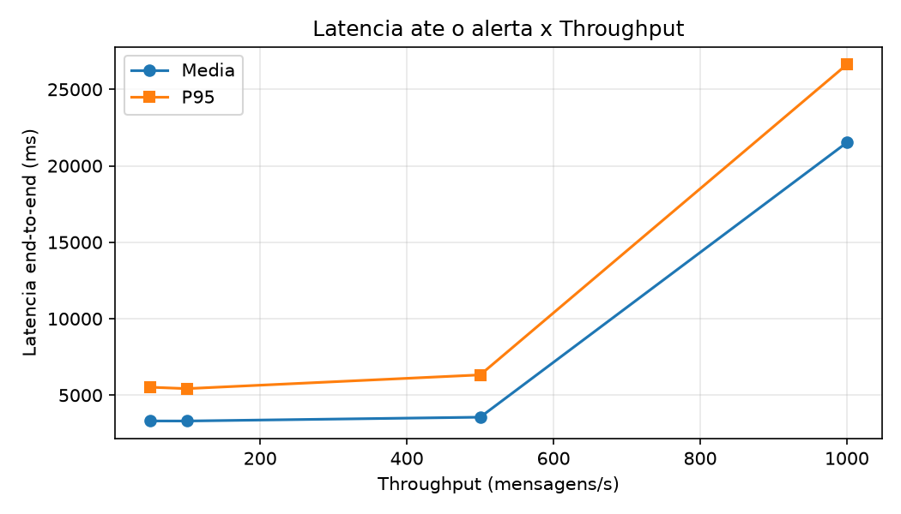
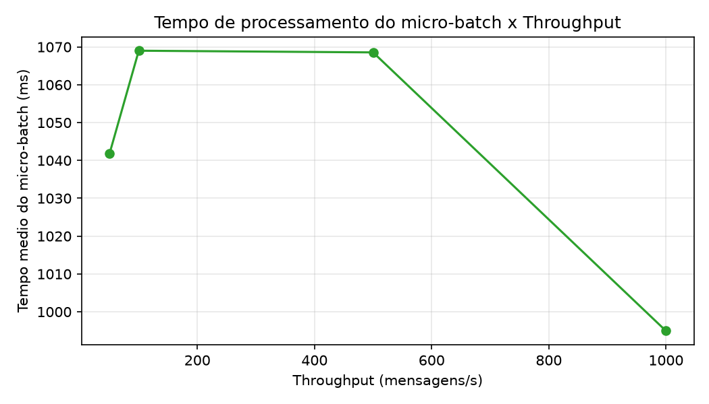
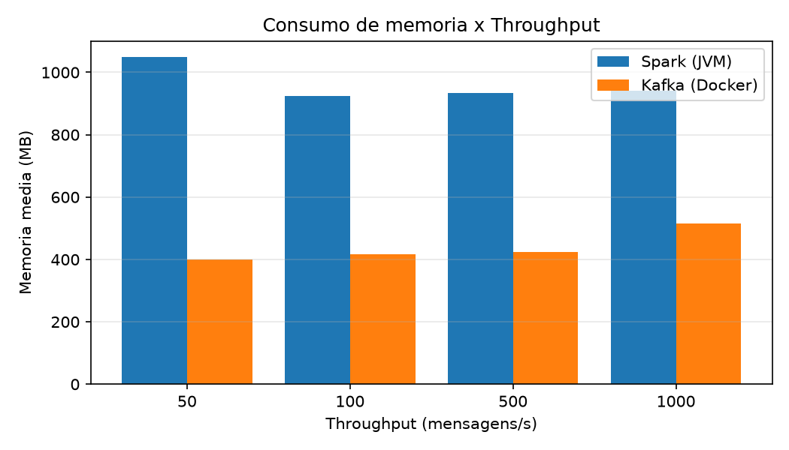
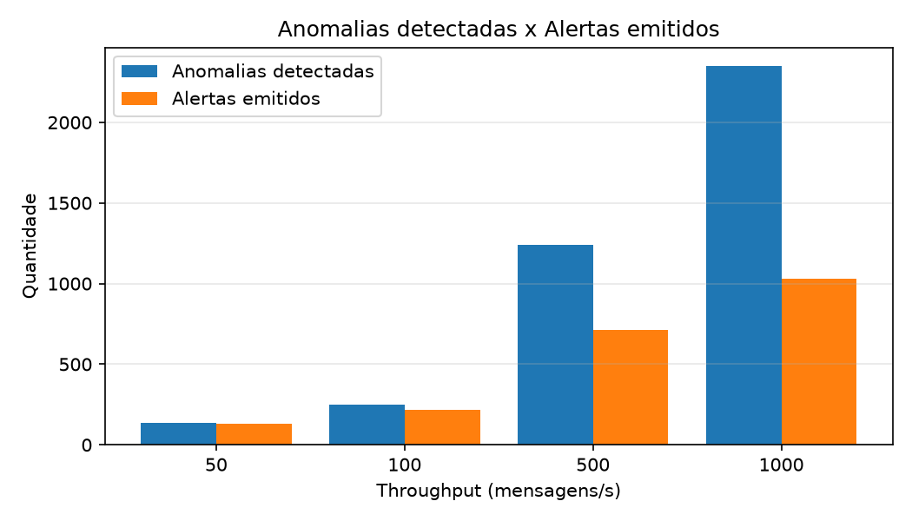
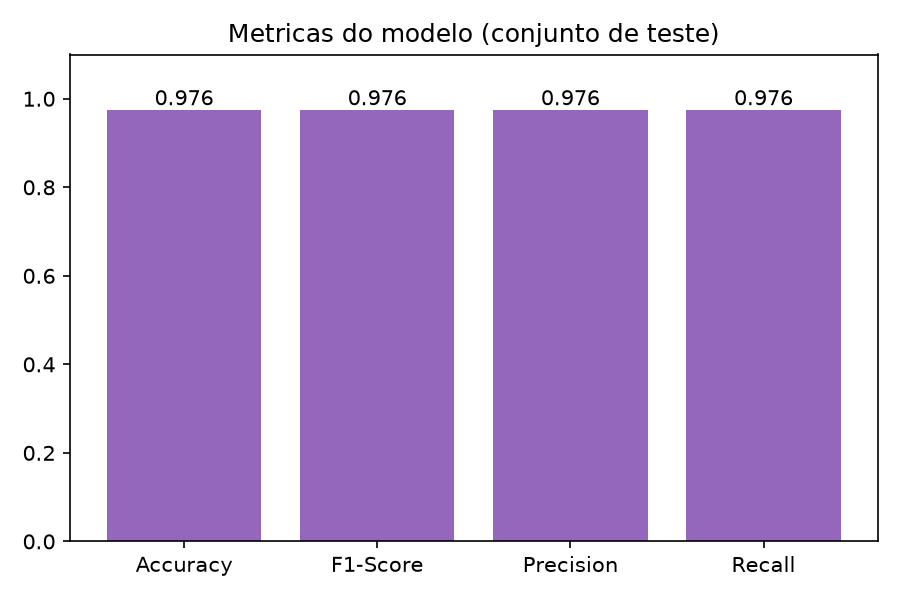
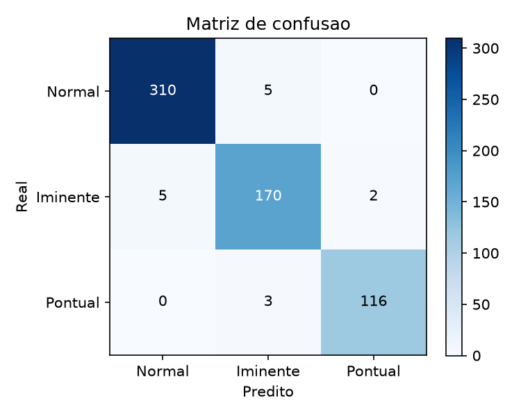

# Relatório Técnico - Trabalho Final de Sistemas Distribuídos

## 1. O que o projeto faz

O objetivo do trabalho foi montar um pipeline que recebe dados de sensores de poços de petróleo em tempo real, detecta anomalias e gera alertas. Usamos o Dataset 3W da Petrobras como base dos dados e três tecnologias principais:

- **Apache Kafka (no Docker):** recebe e distribui as mensagens entre as partes do sistema;
- **Apache Spark Structured Streaming:** lê as mensagens do Kafka e processa em tempo real;
- **pyspark.ml:** modelo de Machine Learning que classifica cada leitura dos sensores.

O fluxo completo ficou assim:

```
Produtor (Python) -> Kafka [telemetria-pocos] -> Spark + ML -> Motor de regras -> Kafka [alertas-operacionais]
```

A vantagem de usar o Kafka no meio é que quem envia os dados não precisa saber quem vai processar, e os dois não precisam estar rodando ao mesmo tempo. Se o Spark ficar mais lento, as mensagens ficam guardadas no Kafka esperando, em vez de se perderem.

## 2. Como o sistema foi construído

### 2.1 Envio dos dados (produtor)

O script `src/produtor/produtor_3w.py` lê os arquivos Parquet do Dataset 3W e envia cada linha como uma mensagem JSON para o tópico `telemetria-pocos`. Cada mensagem recebe também o horário de envio (`timestamp_envio`), o identificador do poço (`poco_id`) e o nome do arquivo de origem. É possível configurar um atraso entre os envios para simular o ritmo dos sensores.

### 2.2 Kafka

O Kafka roda no Docker, configurado com Docker Compose. Usamos dois tópicos:

- `telemetria-pocos`, com 4 partições (para o Spark poder ler em paralelo);
- `alertas-operacionais`, com 1 partição.

Também definimos o formato das mensagens e fizemos um consumidor de teste para validar se as mensagens chegavam corretas e medir a latência do Kafka.

### 2.3 Processamento no Spark e Machine Learning

O consumidor em Spark lê o tópico `telemetria-pocos`. Para cada mensagem, ele:

1. Trata os sensores sem valor, preenchendo com a mediana calculada no Trabalho 2;
2. Normaliza os valores com Z-Score, usando a média e o desvio-padrão do Trabalho 2;
3. Calcula atributos extras, como o maior Z-Score do evento e quantos sensores estão acima de 2 e 3 desvios-padrão;
4. Passa tudo por um modelo de ML (KMeans + Random Forest) que classifica o evento em `NORMAL`, `ANOMALIA_IMINENTE` ou `ANOMALIA_PONTUAL`.

## 3. Motor de regras de alertas

O modelo classifica todos os eventos, mas não faria sentido gerar um alerta para cada anomalia. Como os sensores mandam leituras a todo momento, um poço com problema geraria um alerta por segundo, e o operador acabaria ignorando todos. A ideia do motor de regras é filtrar as anomalias e só gerar alertas que realmente importam.

### Como funciona

A cada micro-batch do Spark:

1. O Spark agrupa os eventos por poço e conta quantas anomalias de cada tipo cada poço teve;
2. Esse resumo (no máximo uma linha por poço) vai para o Python, que aplica as regras;
3. Os alertas aprovados são enviados para o tópico `alertas-operacionais`.

### Regras

| Regra | Quando dispara | Severidade |
|---|---|---|
| R1 - Crítica imediata | Um evento pontual com score do modelo >= 0,85 **e** 2 ou mais sensores acima de 3 desvios-padrão | CRÍTICA |
| R2 - Persistência | 5 ou mais anomalias do mesmo poço em 30 segundos, sendo pelo menos 2 pontuais | CRÍTICA |
| R3 - Tendência iminente | 10 ou mais anomalias iminentes do mesmo poço em 30 segundos | ALERTA PREVENTIVO |

A R1 exige que o modelo e a estatística concordem no mesmo evento, para evitar alarme falso causado por um pico em um único sensor.

Além das regras, existe um **cooldown**: depois de um alerta, o mesmo poço fica 60 segundos sem gerar outro. A exceção é quando a situação piora (por exemplo, de R3 para R1). Nesse caso, o alerta sai mesmo dentro do cooldown.

### Teste

O script `src/alertas/teste_alertas.py` testa o motor sem precisar do Kafka. Ele simula três micro-batches e confere se:

- a R1 dispara para um poço crítico;
- um segundo alerta do mesmo poço é bloqueado pelo cooldown;
- a R3 dispara quando um poço acumula anomalias iminentes;
- um poço em cooldown que piora gera um novo alerta.

O resultado foi o esperado: 3 alertas emitidos e 1 bloqueado.

## 4. Como foram feitos os experimentos

O objetivo era medir a latência (quanto tempo leva desde o envio de um dado até o alerta ser recebido) e o consumo de memória com diferentes volumes de mensagens.

Criamos quatro scripts em `src/benchmarks/`:

- `gerador_carga.py`: envia mensagens para o Kafka a uma taxa fixa (mensagens por segundo). Simula 20 poços, e 2% das mensagens têm uma anomalia forte nos sensores;
- `medir_latencia.py`: lê o tópico de alertas e calcula, para cada alerta, o tempo entre o envio do evento e a chegada do alerta;
- `monitor_memoria.py`: registra a memória usada pelo Spark e pelo Kafka durante o teste;
- `gerar_graficos.py`: lê os resultados e gera os gráficos.

Usamos esse gerador em vez do produtor que lê o Dataset 3W porque precisávamos controlar exatamente quantas mensagens eram enviadas por segundo.

Testamos 4 taxas: **50, 100, 500 e 1000 mensagens por segundo**, com 120 segundos de envio em cada uma. Tudo rodou em uma única máquina com Windows (Kafka no Docker e Spark em modo local). O Spark foi configurado para rodar um micro-batch a cada 2 segundos, lendo no máximo 2000 mensagens por micro-batch.

Nos experimentos, o cooldown foi desligado (`--cooldown 0`). Sem isso, cada poço geraria só um alerta por minuto, e teríamos poucos dados de latência.

## 5. Resultados

### 5.1 Latência

| Taxa (msg/s) | Alertas recebidos | Latência média | Latência P95 | Latência máxima |
|---|---|---|---|---|
| 50 | 130 | 3,3 s | 5,5 s | 7,4 s |
| 100 | 219 | 3,3 s | 5,4 s | 7,9 s |
| 500 | 714 | 3,6 s | 6,3 s | 7,6 s |
| 1000 | 1029 | 21,5 s | 26,6 s | 27,1 s |



De 50 até 500 mensagens por segundo, a latência ficou praticamente igual, em torno de 3,3 segundos. Ou seja, aumentar a carga em 10 vezes quase não mudou o tempo de resposta.

Também medimos só o tempo entre o envio do alerta pelo Spark e a chegada no consumidor, e ele ficou em torno de **6 ms**. Isso mostra que quase toda a latência vem do Spark: o evento espera até 2 segundos pelo próximo micro-batch, e o micro-batch leva cerca de 1 segundo para processar. O Kafka praticamente não pesa no tempo total.

Com 1000 mensagens por segundo, a latência subiu muito (21,5 s de média). A explicação está na próxima seção.

### 5.2 Por que o sistema saturou em 1000 mensagens por segundo

| Taxa (msg/s) | Mensagens por micro-batch (média) | Tempo médio do micro-batch |
|---|---|---|
| 50 | 111 | 1,04 s |
| 100 | 231 | 1,07 s |
| 500 | 1154 | 1,07 s |
| 1000 | 1967 | 1,00 s |



O Spark foi configurado para ler no máximo 2000 mensagens por micro-batch, com um micro-batch a cada ~2 segundos. Isso dá uma capacidade de cerca de 950 mensagens por segundo. Com 1000 mensagens por segundo chegando, o sistema recebia mais do que conseguia ler, e as mensagens começaram a acumular no Kafka. Por isso a latência foi crescendo ao longo do teste: perto de 10 s no começo e 25 s no final.

O interessante é que o tempo de cada micro-batch continuou em ~1 segundo em todas as taxas. O Spark ficava parado metade do tempo esperando o próximo micro-batch. O problema, então, não foi falta de capacidade da máquina, e sim o limite que configuramos. Aumentando esse limite ou diminuindo o intervalo entre micro-batches, o sistema aguentaria mais carga.

Mesmo saturado, o sistema não perdeu nenhuma mensagem: elas ficaram guardadas no Kafka até o Spark conseguir ler.

### 5.3 Memória

| Taxa (msg/s) | Spark (média) | Kafka (média) |
|---|---|---|
| 50 | 1049 MB | 399 MB |
| 100 | 924 MB | 416 MB |
| 500 | 933 MB | 425 MB |
| 1000 | 941 MB | 515 MB |



A memória do Spark ficou em torno de 1 GB em todas as taxas, sem crescer com a carga. Isso acontece porque o Spark processa os dados em micro-batches de tamanho limitado, então nunca carrega tudo de uma vez.

O Kafka subiu de ~400 MB para ~515 MB no teste de 1000 mensagens por segundo, o que faz sentido, porque foi justamente quando as mensagens se acumularam nele.

### 5.4 Anomalias x alertas

| Taxa (msg/s) | Anomalias detectadas | Alertas emitidos | Redução |
|---|---|---|---|
| 50 | 135 | 130 | 3,7% |
| 100 | 249 | 219 | 12,0% |
| 500 | 1239 | 714 | 42,4% |
| 1000 | 2348 | 1029 | 56,2% |



O pipeline detectou cerca de 2% de anomalias em todas as taxas, o que bate com os 2% que o gerador inseria.

O motor de regras reduziu a quantidade de alertas em relação às anomalias, e essa redução aumentou com a carga. Com mais mensagens por micro-batch, o mesmo poço tem várias anomalias juntas, e elas viram um único alerta. Com o cooldown ligado (60 s), a redução seria bem maior, já que cada poço geraria no máximo um alerta por minuto.

Também conferimos que o número de alertas enviados pelo Spark foi igual ao número de alertas recebidos pelo consumidor em todas as taxas, ou seja, nenhum alerta se perdeu no caminho.

### 5.5 Modelo de Machine Learning

| Métrica | Valor |
|---|---|
| Acurácia | 97,55% |
| F1-Score | 0,9755 |
| Precisão | 0,9755 |
| Recall | 0,9755 |





Pela matriz de confusão, os erros do modelo acontecem só entre classes vizinhas (normal com iminente, iminente com pontual). Ele nunca confundiu um evento normal com uma anomalia pontual, que seria o erro mais grave.

Esse resultado precisa ser lido com cuidado: o modelo foi treinado e testado com 3000 registros **sintéticos**, gerados a partir das estatísticas do Trabalho 2, porque os arquivos reais do 3W não estavam na pasta `data/raw`. Além disso, o rótulo usado no treino depende em parte do maior Z-Score do evento, que também é uma das entradas do modelo, o que facilita a classificação. Com os dados reais, a acurácia provavelmente seria menor.

## 6. Limitações

- O modelo foi treinado com dados sintéticos, como explicado acima;
- O gerador de carga cria anomalias muito fortes, então quase todos os alertas dos experimentos foram da regra R1. A R3 só foi testada no teste do motor;
- O estado do motor de regras (janela e cooldown) fica na memória do Python. Se o Spark reiniciar, esse estado se perde;
- Tudo rodou em uma só máquina, com um único broker Kafka e sem replicação. Os resultados não representam um cluster com várias máquinas;
- O monitor de memória conseguiu registrar uma amostra a cada ~4 segundos, porque o comando `docker stats` demora para responder.

## 7. Conclusão

O pipeline funcionou de ponta a ponta: os dados saem do produtor, passam pelo Kafka, são processados pelo Spark com o modelo de ML, e o motor de regras publica os alertas no Kafka.

Nos testes, o sistema respondeu em ~3,3 segundos até 500 mensagens por segundo, e quase todo esse tempo vem do intervalo entre micro-batches do Spark. Em 1000 mensagens por segundo, ele saturou por causa do limite de leitura que configuramos, mas não perdeu nenhuma mensagem graças ao Kafka. A memória do Spark se manteve estável em ~1 GB em todas as taxas.

Como melhorias, seria possível:

- treinar o modelo com os dados reais do 3W;
- aumentar o limite de leitura do Spark para suportar mais carga;
- rodar o Kafka e o Spark com mais de uma máquina.

## 8. Como executar

```bash
# Preparação
pip install -r requirements.txt
docker compose -f configs/docker-compose.yml up -d
docker exec kafka_3w kafka-topics --bootstrap-server localhost:9092 --create --if-not-exists --topic telemetria-pocos --partitions 4 --replication-factor 1
docker exec kafka_3w kafka-topics --bootstrap-server localhost:9092 --create --if-not-exists --topic alertas-operacionais --partitions 1 --replication-factor 1
python -m src.ml.treinar_modelo
python -m src.alertas.teste_alertas

# Experimento (4 terminais, nesta ordem; trocar a taxa a cada rodada)
python -m src.alertas.pipeline_alertas --taxa 100 --cooldown 0
python -m src.benchmarks.medir_latencia --taxa 100 --duracao 150
python -m src.benchmarks.monitor_memoria --taxa 100 --duracao 150 --container kafka_3w
python -m src.benchmarks.gerador_carga --taxa 100 --duracao 120

# Gráficos
python -m src.benchmarks.gerar_graficos
```

No Windows, o Spark precisa do `winutils.exe` e do `hadoop.dll` configurados na variável `HADOOP_HOME`.